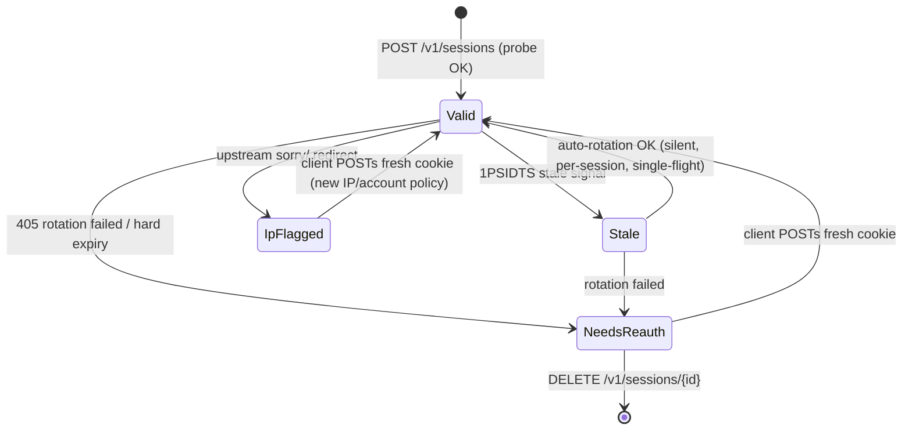

# Module Specification: `session-vault`

**Module ID:** `session-vault`
**Crate:** `gemini-bridge-identity` (`crates/identity`) — vault lives inside the identity crate; no new crate is created
**Initiative:** Session Vault Multi-Tenant (BYOS / clean cutover)
**Depends On:** `config`, `transport`
**Consumers:** `gemini-adapter`, `upload`, `http-server`, `health-admin`
**Parent Spec:** `SPEC.md` §2.1 (initiative row), §10 decision 12
**Status:** Draft for Review (Phase 1 of `agent-skills:spec-driven-development`)

---

## 0. Capability Map (initiative Phase 0 — approved for review)

Single capability bundle; five modules below are build slices, not independently
shippable features. One spec covers them; dependency order = build order.

| Module id (slice) | Responsibility | Depends on |
|---|---|---|
| `vault-store` | `sessions.sqlite` vault: CRUD, encrypted cookie envelope, token hashing, per-session rotation locks | `config`, `transport` |
| `vault-api` | `POST/GET/DELETE /v1/sessions*` routes, dual auth (api_key + session token), `401` error taxonomy | `vault-store` |
| `vault-wiring` | Per-request session resolution, adapter/download consumer plumbing, `405` rotation per session | `vault-api` |
| `vault-scoping` | `session_id` column in conversations + media index; tenant isolation | `vault-wiring` |
| `vault-cutover` | Delete `cookies.json` / `/admin/reauth` / single-session state; CLI + docs migration | `vault-scoping` |

Build order: `vault-store` → `vault-api` → `vault-wiring` → `vault-scoping` → `vault-cutover`

---

## 1. Objective & Responsibility

Replace the single operator-owned session with a **multi-tenant session vault**:
each client application creates and manages its own Gemini session through the
bridge API. The operator never touches the bridge again after deployment.

**User stories:**

- **US-1 (BYOS):** As a client app, I POST my Gemini `Cookie` header once to
  `POST /v1/sessions`, receive a session token, and use it on every request.
  If my session dies I get `401 needs_reauth`, I re-login in *my* app, and
  POST the fresh cookie again.
- **US-2 (auto-rotate):** As a client, I never see soft expiry: when
  `__Secure-1PSIDTS` goes stale (405), the bridge rotates it per-session
  silently and retries once.
- **US-3 (operator-free):** As the operator, I deploy, set `BRIDGE_SECRET` +
  `server.api_key`, and never paste a cookie or call `/admin/reauth` again.

**What the bridge does NOT do:** automate Google login (no password ever
reaches the bridge; no headless browser in the runtime), and it cannot recover
a hard-expired session (`__Secure-1PSID`/`SAPISID` dead) — that is client
re-auth by contract.

---

## 2. Tech Stack

Unchanged from root `SPEC.md` §3: Rust edition 2024, axum 0.8, rusqlite
(bundled), `thiserror`, `wiremock`, `insta`. **No new crates.** Vault reuses
`crates/identity/src/crypto.rs` (Argon2id GBCK envelope) and the existing
`sha2` dependency for token hashes.

---

## 3. Commands

```bash
# Build & test (unchanged workspace commands; quality gate applies)
cargo build --workspace
cargo test --workspace
cargo clippy --workspace --all-targets --all-features -- -D warnings
cargo fmt --all -- --check

# Operator bootstrap (creates the FIRST vault session instead of cookies.json)
cargo run --bin gemini-bridge -- --config bridge.toml auth login

# Client flows exercised manually
curl -sS -X POST http://127.0.0.1:8090/v1/sessions \
  -H "Authorization: Bearer $BRIDGE_SERVER_API_KEY" \
  -H "Content-Type: application/json" \
  -d '{"cookie": "__Secure-1PSID=...; __Secure-1PSIDTS=...; SAPISID=...", "label": "client-a"}'
curl -sS http://127.0.0.1:8090/v1/sessions/current \
  -H "Authorization: Bearer $BRIDGE_SERVER_API_KEY" \
  -H "X-Session-Token: <token from create>"
curl -sS -X POST http://127.0.0.1:8090/v1/chat/completions \
  -H "Authorization: Bearer $BRIDGE_SERVER_API_KEY" \
  -H "X-Session-Token: <token>" -d '{"model":"gemini-2.0-flash","messages":[{"role":"user","content":"hi"}]}'
```

---

## 4. Project Structure

```
crates/identity/src/
├── vault.rs          # NEW — VaultStore: sessions.sqlite CRUD, tokens, locks (vault-store)
├── session.rs        # REWRITE — session-scoped bootstrap/rotation replaces single-session state
├── crypto.rs         # EXTEND — GBCK envelope applied per-cookie row (reuse as-is if possible)
├── storage.rs        # DELETE — cookies.json reader/writer removed at cutover
├── rotation.rs       # KEEP — per-session rotation entry point (same wire logic)
└── parser.rs         # KEEP — cookie header parsing + SAPISIDHASH
crates/http-server/src/
├── handlers/sessions.rs  # NEW — /v1/sessions* handlers (vault-api)
├── handlers/health.rs    # EDIT — drop /admin/reauth; /readyz = vault aggregate
└── lib.rs                # EDIT — routes, dual-auth middleware, session-scoped AppState (vault-wiring)
crates/gemini-adapter/src/lib.rs  # EDIT — consume per-request session handle (vault-wiring)
crates/upload/src/media_fetch.rs  # EDIT — MediaDownloader takes session cookie per call (vault-wiring)
crates/conversation-store/        # EDIT — MIGRATION_V3: conversations.session_id (vault-scoping)
crates/media-store/src/index.rs   # EDIT — media_metadata.session_id column (vault-scoping)
src/main.rs / src/cli.rs          # EDIT — auth login writes a vault session (vault-cutover)
docs/operations.md, README.md     # EDIT — credential flow rewritten (vault-cutover)
```

Tests: `crates/identity/tests/vault_test.rs` (new), existing
`identity_test.rs` / e2e suites migrated; `tests/common/` gains a
create-session helper.

---

## 5. Code Style

Follow root `SPEC.md` §6 (edition 2024, `thiserror` for domain errors, no
`.unwrap()` in production paths, redacted `Debug`). Vault-specific:

```rust
/// One tenant's Gemini session. Secrets never appear in Debug or logs.
pub struct VaultSession {
    pub id: String,              // "ses_" + 16 random bytes, URL-safe
    pub label: Option<String>,
    pub status: SessionStatus,
    pub imported_at: String,     // RFC3339
}

impl fmt::Debug for VaultSession {
    fn fmt(&self, f: &mut fmt::Formatter<'_>) -> fmt::Result {
        f.debug_struct("VaultSession")
            .field("id", &self.id)
            .field("label", &self.label)
            .field("status", &self.status)
            .field("psid", &"***REDACTED***")
            .finish_non_exhaustive()
    }
}
```

- Token: `ses_` + 32 bytes `OsRng`; stored as `sha256(token)`; raw token
  returned only in the create response.
- Per-session rotation lock: `Mutex`-guarded map `session_id -> Arc<tokio::sync::Mutex<()>>`,
  never a single global lock; never hold across unrelated sessions' awaits.
- Error codes are stable snake_case strings (`invalid_api_key`,
  `invalid_session_token`, `needs_reauth`) returned through the existing
  `OpenAiErrorResponse` shape.

---

## 6. API & Behavior

### 6.1 Routes

| Method & Path | Auth | Behavior |
|---|---|---|
| `POST /v1/sessions` | api_key | Parse cookie → probe `/app` → persist encrypted → `{id, token, session_status}`. Re-POST with same tenant = replace (atomic). Probe failure leaves prior session untouched. |
| `GET /v1/sessions/current` | api_key + `X-Session-Token` | `{session_status, cookie_age_secs, build_label}` for the caller's session only. |
| `DELETE /v1/sessions/{id}` | api_key + token matching `{id}` | Purge row; subsequent requests → `invalid_session_token`. |
| `/v1/chat/*`, `/v1/files*`, `/v1/images*`, `/v1/conversations*`, `/v1/videos*` | api_key + token | Unchanged contracts; session resolved per request from token. |
| `GET /healthz` | public | Unchanged. |
| `GET /readyz` | public | Aggregate: `{vault: {total, valid, needs_reauth, ip_flagged}}` — 200 iff ≥1 valid session, else 503. |
| `GET /admin/status` | admin (api_key) | All sessions' status/age/label — no secret values. |

**Removed at cutover:** `POST /admin/reauth`, `cookies.json`, global
single-session identity state.

### 6.2 Dual auth (2b: keduanya wajib)

Middleware order: api_key check (existing `constant_time_eq`) → extract
`X-Session-Token` header → vault lookup by token hash → attach resolved
session to request extensions. Missing/wrong either → `401` with the matching
code. `401 needs_reauth` is returned at resolve time when stored status is
`needs_reauth`/`ip_flagged` — the upstream is never called.

### 6.3 Session lifecycle & rotation



- Soft expiry (`__Secure-1PSIDTS`): auto-rotate via `/app`, bounded,
  single-flight **per session**, persist updated row — client unaffected.
- Hard expiry (probe 401 / rotation `NeedsReauth`): row status flips
  `needs_reauth`; requests fail fast with `401 needs_reauth`; recovery is
  client-side re-auth (US-1). No server-side retry loops.

### 6.4 Scoping (tenant isolation)

- `conversations.session_id` (nullable → V3 migration, indexed): every
  conversation/list/branch/history call filters by the caller's session.
  Legacy `NULL` rows are claimed by the **first created session** (single-operator
  upgrade path; documented in operations.md).
- `media_metadata.session_id`: gallery/file/image lookups filtered by session;
  download deletion scoped likewise.
- Rate limiter bucket key becomes `"{api_key_hash}:{session_id}"` instead of
  the static `"authenticated"` bucket.

### 6.5 Config

No new required keys. `server.api_key` stays mandatory on non-localhost and
for `/admin/*` (unchanged). `storage.data_dir` gains `sessions.sqlite`.
`BRIDGE_SECRET` encrypts cookie envelopes exactly as it encrypted
`cookies.json`. Optional later (out of scope): `storage.max_sessions`.

---

## 7. Testing Strategy

1. **Unit (`crates/identity/tests/vault_test.rs`):** token generate/hash
   round-trip; create→resolve→delete; replace-on-re-POST atomicity
   (probe failure preserves old row); wrong-key `BRIDGE_SECRET` fails closed;
   redacted `Debug`; per-session lock (two sessions rotate concurrently,
   single session single-flights).
2. **Wire (`wiremock`):** probe OK/fail; 405 → rotation → retry uses rotated
   cookie; rotation failure → `needs_reauth` + stored row updated;
   `sorry/` → `ip_flagged`.
3. **HTTP integration:** dual-auth matrix (no api_key / no token / wrong
   token / both OK) → exact status + error code; `401 needs_reauth` short-circuits
   before upstream (assert zero upstream hits); `/readyz` aggregate states;
   conversation + media queries do not leak across two sessions (tenant
   isolation regression test).
4. **Migrations:** V3 upgrade on a V1/V2-shaped fixture; NULL rows claimed by
   first session.
5. **E2E migrate:** existing suites adopt `tests/common` session-create
   helper; resilience drills cover cookie-expiry at the per-session level.
6. Live/credentialed runs remain opt-in, operator-provided only (never CI).

---

## 8. Acceptance Criteria

1. Client completes US-1 flow with zero operator involvement: create session →
   chat → simulate hard expiry → `401 needs_reauth` → re-create → chat OK.
2. Soft expiry: 405 drill shows rotated `__Secure-1PSIDTS` persisted for the
   owning session only; other sessions untouched; client sees no error.
3. A session token never grants access to another session's conversations or
   media (negative test passes).
4. Wrong api_key → `401 invalid_api_key`; wrong token → `401 invalid_session_token`;
   dead session → `401 needs_reauth` with zero upstream calls.
5. `cookies.json` and `/admin/reauth` are gone; `auth login` produces a vault
   session; `docs/operations.md` credential flow matches behavior.
6. `cargo fmt --check` + `clippy -D warnings` + full workspace tests green.

---

## 9. Boundaries

- **Always:** probe `/app` before persisting any cookie; encrypt cookie
  envelope when `BRIDGE_SECRET` set; redact all secret representations
  (`***REDACTED***`); keep rotation bounded/single-flight per session;
  scope every tenant query by `session_id`; keep the dual-auth check
  constant-time on the api_key.
- **Ask first:** changing route/auth contracts; new crate dependency; WAL
  pragma on `bridge.sqlite`; migrations touching existing rows beyond the
  documented NULL-claim; relaxing `401` taxonomy.
- **Never:** accept a Google password or run headless login in the bridge;
  log cookie/token values; commit real cookies; auto-retry hard-expired
  sessions; cross-session data leakage; unbounded rotation loops.

---

## 10. Open Questions

1. `X-Session-Token` header name vs. reusing `Authorization` (a second
   `Bearer`)? **Default taken: separate header** — preserves OpenAI SDK
   compatibility (SDKs own the `Authorization` field).
2. Vault row limit / idle eviction: **default taken: unlimited, out of scope**,
   revisit when multi-client scale is real.
3. Should `GET /v1/sessions` (list own sessions) exist? **Default taken: no**
   — create returns the id; current/delete cover the loop. Add on demand.